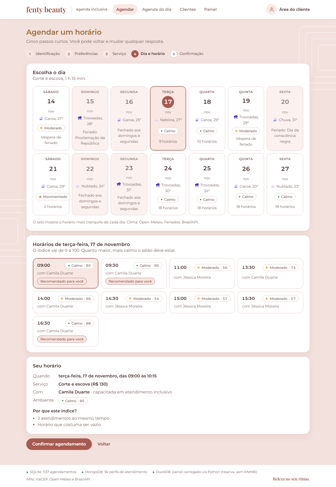
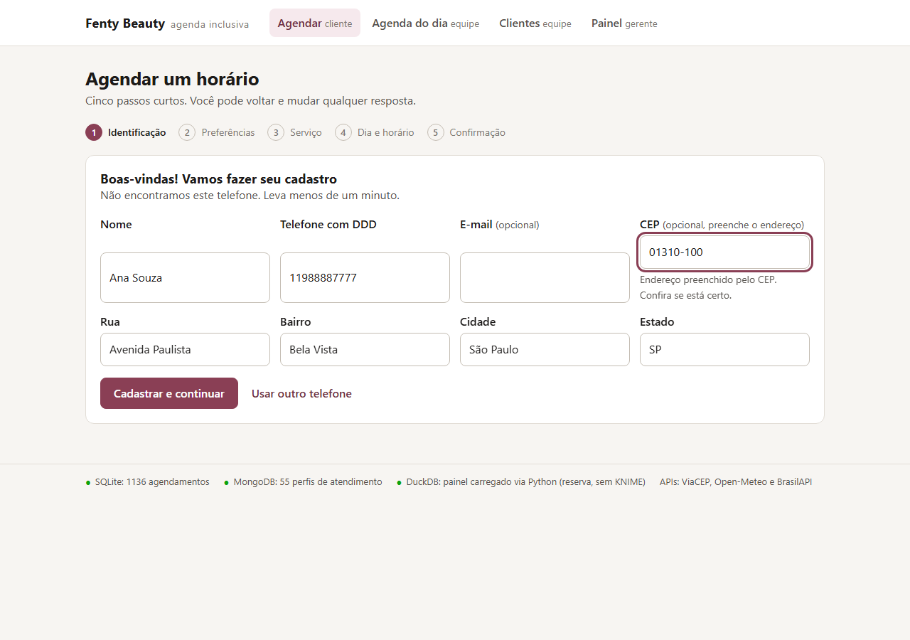
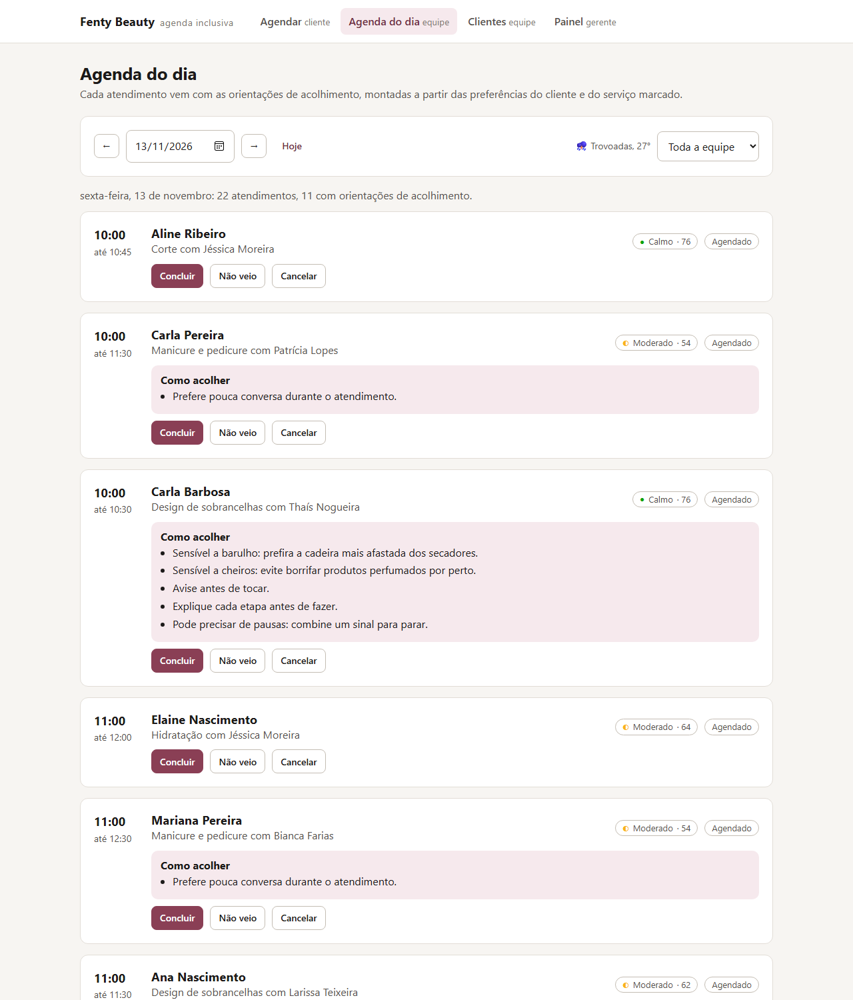
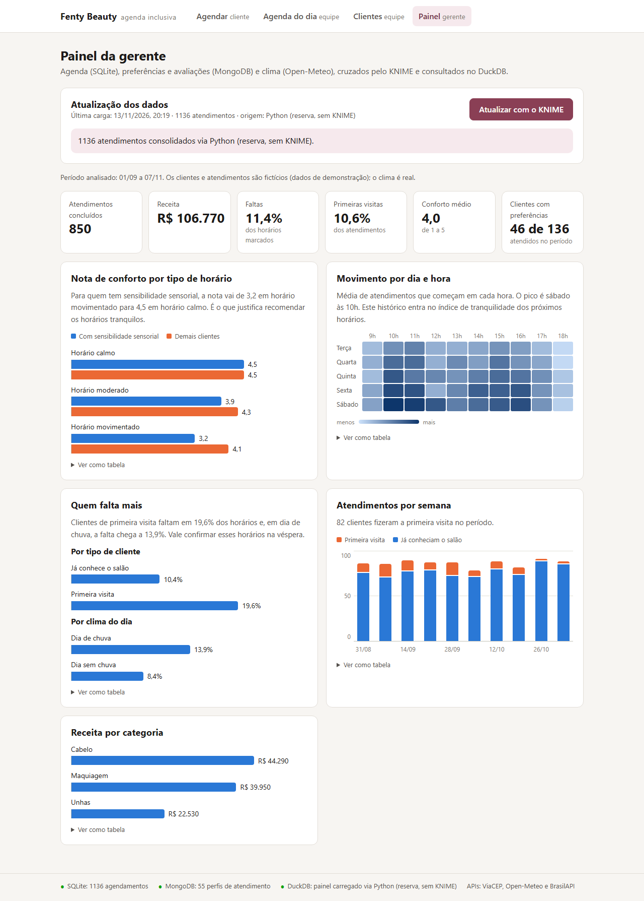

# Fenty Beauty — agenda inclusiva

Sistema de agendamento para o salão de beleza Fenty Beauty (gerente, cabeleireiras, manicures e maquiadoras). Projeto final da disciplina de Integração de Dados.

## Equipe

| Integrante | Responsabilidade |
|---|---|
| _(Ícaro)_ | _(backend e APIs)_ |
| _(Vitória e Isadora)_ | _( frontend)_ |
| _(Vitor e Kevin)_ | _( KNIME e painel)_ |

## O problema

O salão tem três dificuldades que se alimentam:

1. **Agendamento de horários.** A agenda é feita à mão, com conflitos de horário e faltas.
2. **Clientes novos.** Quem vem pela primeira vez não sabe como o atendimento funciona, o cadastro é demorado e a taxa de faltas é maior.
3. **Inclusão de clientes neurodivergentes.** Barulho de secador, cheiro de tintura, luz forte, toque e conversa podem tornar a visita muito desconfortável. Hoje a equipe só descobre isso na hora.

## A solução

Uma agenda que cruza dados de fontes diferentes para responder a uma pergunta que o salão não conseguia responder: **qual horário vai ser tranquilo para esta pessoa?**

- **Índice de tranquilidade (0 a 100)** para cada horário livre. Ele junta quem já está agendado e o barulho/cheiro desses serviços (SQLite), o movimento histórico daquele dia e hora (DuckDB), a previsão do tempo (Open-Meteo) e as vésperas de feriado (BrasilAPI). O perfil do cliente (MongoDB) dá peso a cada fator: para quem é sensível a barulho, um secador ligado ao lado pesa mais. O sistema explica em texto simples por que cada horário recebeu aquela nota.
- **Preferências de atendimento**, opcionais e com consentimento. Não pedem diagnóstico: perguntam o que incomoda (barulho, luz, cheiros, toque) e o que ajuda (pouca conversa, aviso antes de tocar, pausas, acompanhante, comunicação por escrito).
- **Cartão de acolhimento** na agenda da equipe. Cruza as preferências do cliente com as características do serviço marcado e entrega orientações prontas, por exemplo: "Este serviço usa aparelho barulhento: ofereça protetor de ouvido ou secagem natural".
- **Primeira visita mais simples.** O CEP preenche o endereço (ViaCEP), o sistema reserva 15 minutos a mais para o acolhimento e mostra o passo a passo do serviço, com avisos sensoriais em cada etapa.
- **Painel da gerente** com faltas por tipo de cliente e por clima, movimento por dia e hora, e a nota de conforto por tipo de horário, que mostra se recomendar horários calmos está funcionando.

## Telas

**Escolha do horário.** Cada dia mostra o clima e o horário mais tranquilo; cada horário tem o índice, a recomendação para o perfil do cliente e o motivo da nota.



**Cliente nova.** O CEP preenche o endereço pela ViaCEP.



**Agenda da equipe.** Cada atendimento traz o cartão "Como acolher", montado a partir das preferências do cliente e do serviço marcado.



**Painel da gerente.** Indicadores e gráficos sobre a tabela consolidada no DuckDB.



## Arquitetura

```
                 ┌──────────────────────── React (Vite) ────────────────────────┐
                 │  Agendar (cliente) · Agenda do dia · Clientes · Painel       │
                 └───────────────────────────────┬──────────────────────────────┘
                                                 │ /api
                 ┌───────────────────────────────┴──────────────────────────────┐
                 │                      FastAPI (Python)                        │
                 └──┬──────────────┬───────────────┬────────────────────┬───────┘
                    │              │               │                    │
              ┌─────┴─────┐  ┌─────┴──────┐  ┌─────┴──────┐   ┌─────────┴─────────┐
              │  SQLite   │  │  MongoDB   │  │   DuckDB   │   │   APIs externas   │
              │ operação  │  │ documentos │  │  análise   │   │ ViaCEP            │
              │           │  │            │  │            │   │ Open-Meteo        │
              │ clientes  │  │ perfis     │  │ fato_      │   │ BrasilAPI         │
              │ equipe    │  │ roteiros   │  │ atendimen- │   └─────────┬─────────┘
              │ serviços  │  │ feedbacks  │  │ tos        │             │
              │ agenda    │  │ clima ◄────┼──┼────────────┼─────────────┘
              └─────┬─────┘  └─────┬──────┘  └──▲───┬─────┘
                    │              │ CSV        │   │ movimento histórico volta
                    │              ▼            │   │ para o índice de tranquilidade
                    │      ┌──────────────────┐ │   ▼
                    └─────►│  KNIME workflow  ├─┘
                           │  junções+regras  │ CSV consolidado e planilha Excel
                           └──────────────────┘
```

### Por que cada tecnologia

| Tecnologia | Papel | Por que esta |
|---|---|---|
| **SQLite** | Banco operacional: clientes, equipe, serviços, agendamentos | Dados relacionais com integridade (chaves estrangeiras, transação na reserva para não haver dois clientes no mesmo horário). Não exige instalação. |
| **MongoDB** | Perfis sensoriais, roteiros de atendimento, feedbacks, clima e feriados | Documentos de formato variável: cada perfil tem campos diferentes, cada roteiro tem uma lista de etapas, e as respostas das APIs são guardadas como chegam. |
| **DuckDB** | Banco analítico do painel | Consultas de agregação sobre a tabela consolidada, lendo o CSV do KNIME direto. |
| **KNIME** | Integração: junta SQLite + MongoDB + clima em uma tabela fato, aplica as regras de negócio do painel e monta a planilha em Excel para a gerente | Workflow visual com conector de banco, leitores de arquivo, junções e regras (Rule Engine) que dá para ler e mudar sem programar. |
| **ViaCEP** | Endereço a partir do CEP | Cadastro mais rápido para cliente novo. |
| **Open-Meteo** | Previsão e histórico do tempo | Trovoada, chuva forte e calor entram no índice; chuva é cruzada com as faltas. |
| **BrasilAPI** | Feriados nacionais | O salão fecha no feriado e a véspera costuma ser mais cheia. |
| **FastAPI** | Backend em Python | |
| **React + Vite** | Frontend | |

### O caminho dos dados

1. O cliente agenda. O agendamento vai para o **SQLite**; as preferências, para o **MongoDB**.
2. O backend busca o clima na **Open-Meteo** e os feriados na **BrasilAPI** e guarda no **MongoDB**. Se uma API cair, o sistema continua com o que já foi guardado.
3. Na atualização do painel, o backend exporta do MongoDB os perfis, os feedbacks e o clima para `data/staging/`.
4. O **KNIME** lê os agendamentos direto do SQLite (com serviço e profissional), junta com os três arquivos, classifica cada atendimento (nível de tranquilidade e dia de chuva) e grava `data/consolidado/fato_atendimentos.csv`. Num segundo ramo, monta a mesma tabela como planilha de Excel para a gerente (`data/consolidado/fenty_atendimentos.xlsx`).
5. O backend carrega esse arquivo no **DuckDB**, que responde ao painel.
6. O movimento histórico calculado no DuckDB volta para a operação: ele é um dos fatores do índice de tranquilidade dos próximos horários.

### Por que o KNIME, se o backend já é em Python?

- **É onde a integração fica visível.** Cada nó mostra de onde vem cada coluna, e dá para abrir a tabela depois de cada junção para conferir o resultado. As junções são à esquerda: nenhum atendimento se perde quando falta perfil, avaliação ou clima.
- **As regras do painel ficam fora do código.** O que conta como horário calmo (índice 75 ou mais) e o que é dia de chuva (5 mm ou mais) estão em nós Rule Engine. Uma analista consegue ler e ajustar essas regras sem mexer no Python.
- **O Python é a reserva, não o caminho principal.** `etl.consolidar_reserva` repete a mesma junção e as mesmas regras só para o painel não ficar vazio numa máquina sem KNIME. A origem de cada carga aparece no painel e no rodapé, então os dois caminhos nunca se confundem.
- **Limitação:** por causa da reserva, as regras existem em dois lugares (KNIME e `etl.aplicar_regras`) e precisam mudar juntas. Os limites de calmo e moderado também são usados pela agenda (`agenda.nivel_do_indice`). A planilha em Excel só sai pelo KNIME; a reserva em Python alimenta apenas o painel.

## Como executar

Pré-requisitos: Python 3.11+, Node 18+, MongoDB rodando em `localhost:27017` e KNIME 5.x.

```powershell
# 1. Backend (terminal 1)
cd backend
python -m venv .venv
.venv\Scripts\pip install -r requirements.txt
.venv\Scripts\python -m app.seed                 # cria os dados de demonstração
.venv\Scripts\python -m uvicorn app.main:app --port 8000

# 2. Frontend (terminal 2)
cd frontend
npm install
npm run dev
```

Abra <http://localhost:5173>. A documentação da API fica em <http://localhost:8000/docs>.

O `seed` apaga e recria os dados do projeto (as tabelas do SQLite e as coleções `perfis_sensoriais`, `roteiros` e `feedbacks` do banco `fenty_beauty` no MongoDB). Rode com o backend parado, porque o DuckDB aceita um processo por vez.

### Workflow do KNIME

O workflow está em `knime/fenty_consolidacao` e também empacotado em `knime/fenty_consolidacao.knwf`.

O conector SQLite do KNIME só aceita caminho absoluto. Por isso, os seis nós que leem ou gravam arquivos (1, 3, 4, 5, 9 e 26) usam o caminho completo da pasta `data/`. Numa máquina nova, ou se a pasta do projeto mudar de lugar, rode antes:

```powershell
backend\.venv\Scripts\python knime\configurar_caminhos.py
```

O script grava os caminhos certos e gera o `.knwf` de novo. Com isso, o workflow funciona aberto de qualquer workspace do KNIME.

1. No KNIME, importe `knime/fenty_consolidacao.knwf` (**File → Import KNIME Workflow**) ou troque o workspace para a pasta raiz deste projeto.
2. No app, em **Painel**, clique em **Atualizar com o KNIME**. Isso exporta os arquivos do MongoDB para `data/staging/`.
3. No KNIME, execute todos os nós (**Execute all**).
4. De volta ao Painel, clique em **Carregar resultado do KNIME**.

O que cada nó faz:

| Nós | Função |
|---|---|
| 1 e 2 | Conectam no SQLite e leem os agendamentos com serviço e profissional |
| 3, 4 e 5 | Leem os arquivos exportados do MongoDB: perfis, avaliações e clima |
| 6, 7 e 8 | Juntam perfil do cliente, nota de conforto e clima do dia (junção à esquerda) |
| 10 e 11 | Regras: nível de tranquilidade (calmo, moderado, movimentado) e dia de chuva |
| 9 | Grava `data/consolidado/fato_atendimentos.csv`, que o DuckDB carrega |
| 12 a 18 | Preparam a planilha: status e Sim/Não por extenso, tiram as notas de cada sentido do perfil sensorial, põem as colunas em ordem e com nome em português, e ordenam por data e hora |
| 19 a 25 | Resumos dos atendimentos concluídos: por profissional e conforto por nível de tranquilidade e sensibilidade, com as médias arredondadas |
| 26 | Grava `data/consolidado/fenty_atendimentos.xlsx` com três abas |

A planilha tem três abas:

- **Atendimentos**: um atendimento por linha, com serviço, profissional, status, índice e nível de tranquilidade, notas e clima do dia.
- **Por profissional**: atendimentos concluídos, receita e notas médias de cada profissional.
- **Conforto por nível**: nota média de conforto em cada nível de tranquilidade, separada por sensibilidade sensorial (Alta, Baixa, Sem perfil). É a tabela que mostra se os horários calmos fazem diferença para quem tem sensibilidade.

A planilha é gravada de novo a cada execução. Feche-a no Excel antes de executar o workflow, senão o nó 26 não consegue gravar (o CSV do nó 9 é gravado normalmente).

Se um nó acusar arquivo não encontrado, rode `knime\configurar_caminhos.py` (veja acima). Se o workflow já estiver importado no KNIME, feche-o sem salvar e passe a pasta da cópia para o script, por exemplo `knime\configurar_caminhos.py "C:\Users\voce\knime-workspace\fenty_consolidacao"`.

Se o workflow for alterado no KNIME, exporte de novo por **File → Export KNIME Workflow** (sem os dados) e substitua o `.knwf` do projeto.

Com a extensão gratuita **KNIME Batch Executor** instalada, o botão **Atualizar com o KNIME** faz os quatro passos sozinho. Se o KNIME não estiver em `C:\Program Files\KNIME`, defina a variável de ambiente `KNIME_EXE`.

Logo depois do `seed`, o painel já abre com uma carga inicial feita em Python, para não ficar vazio. A origem de cada carga aparece no painel e no rodapé ("origem: KNIME" ou "origem: Python").

### Configuração opcional (variáveis de ambiente)

| Variável | Padrão | Para quê |
|---|---|---|
| `MONGO_URL` | `mongodb://localhost:27017` | Endereço do MongoDB |
| `SALAO_CIDADE`, `SALAO_LAT`, `SALAO_LON` | São Paulo | Local do salão para a previsão do tempo |
| `KNIME_EXE` | `C:\Program Files\KNIME\knime.exe` | Executável do KNIME |

## Roteiro da demonstração (5 minutos)

| Tempo | O que mostrar |
|---|---|
| 0:00 | **Problema**: agenda manual, cliente novo perdido, cliente neurodivergente que só é entendido na hora. |
| 0:40 | **Arquitetura**: o diagrama acima. Três bancos, cada um com um papel; KNIME no meio; três APIs. |
| 1:30 | **Agendar como Marina** (telefone `11 99999-0001`, tem perfil sensorial). Mostrar as preferências, escolher "Corte e escova" e abrir os horários: selo de tranquilidade, "Recomendado para você" e o "Por que este índice?". |
| 2:30 | **Agendar como cliente nova** (qualquer telefone novo). Digitar um CEP e ver o endereço preenchido; notar os 15 minutos de acolhimento e o passo a passo na confirmação. |
| 3:10 | **Agenda do dia**: o cartão "Como acolher" do atendimento recém-criado. |
| 3:40 | **KNIME**: executar o workflow; mostrar as três junções, as duas regras (Rule Engine) e abrir a planilha gerada na aba "Conforto por nível". |
| 4:10 | **Painel**: carregar o resultado; nota de conforto por tipo de horário, faltas em dia de chuva, mapa de movimento. |
| 4:45 | Fechamento: o que o painel aprende volta para o índice de tranquilidade. |

## Estrutura do repositório

```
backend/app/
  main.py         rotas da API
  agenda.py       horários livres e índice de tranquilidade
  acolhimento.py  orientações para a equipe (perfil x serviço)
  apis.py         ViaCEP, Open-Meteo, BrasilAPI (com cache no MongoDB)
  etl.py          staging -> KNIME -> DuckDB
  db_sqlite.py    esquema e conexão do banco operacional
  db_mongo.py     coleções de documentos
  db_duck.py      carga e consultas do painel
  seed.py         dados de demonstração
frontend/src/
  paginas/        Agendar, Agenda, Clientes, Painel
  componentes/    formulário de preferências, gráficos, selos
knime/fenty_consolidacao/       workflow de integração
knime/fenty_consolidacao.knwf   o mesmo workflow, empacotado para importar
knime/configurar_caminhos.py    aponta os nós do workflow para a pasta data/
docs/telas/       capturas de tela usadas neste README
data/             bancos e arquivos gerados (fora do Git)
```

## Cuidados com os dados

- As preferências de atendimento são dado pessoal sensível (LGPD). Por isso são opcionais, dependem de consentimento explícito, não registram diagnóstico e são apagadas quando o cliente retira o consentimento. A planilha em Excel, que circula com mais facilidade, leva só a sensibilidade resumida (Alta, Baixa, Sem perfil) e o código do cliente, sem nome nem a nota de cada sentido.
- Os clientes e atendimentos do `seed` são fictícios. As relações que o painel mostra (por exemplo, conforto maior em horário calmo) foram embutidas nos dados de demonstração para a tela ter o que mostrar; com dados reais, o painel serve justamente para verificar se elas existem.
- O projeto não tem login. Em produção, as áreas da equipe e da gerente precisariam de autenticação.
